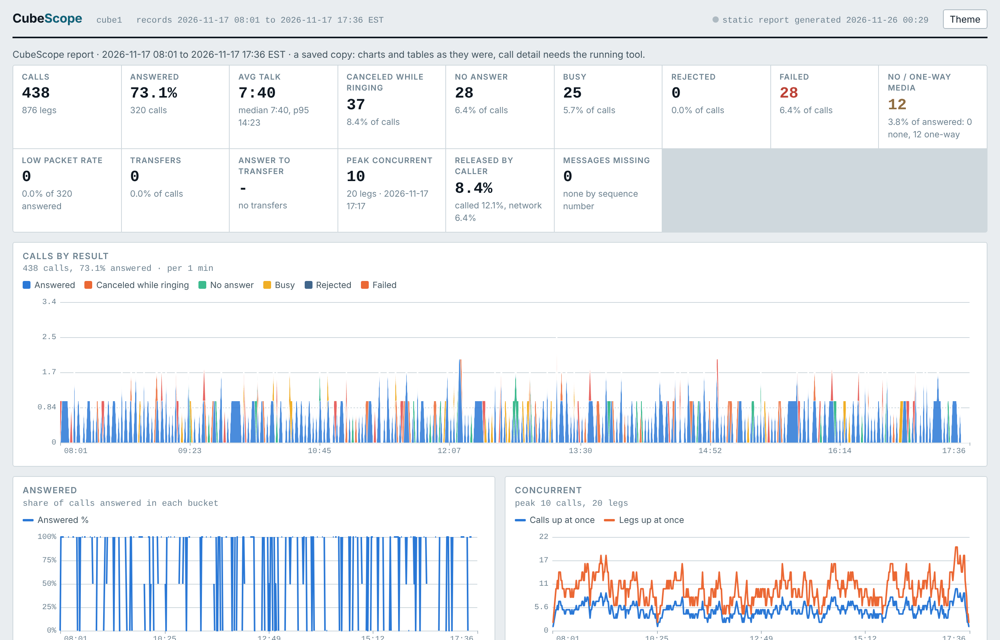

# CUBEScape (CubeScope)

**Project credit:** My coworker [Bastian74](https://github.com/Bastian74), whom I follow on GitHub, conceived and created this tool. I use it.

CubeScope turns the call records a Cisco CUBE (Cisco Unified Border Element) writes into a dashboard in your web browser. It joins the pieces of each call back together and shows how calls ended, who hung up, whether the audio worked, and whether records are going missing. Everything stays on your computer: there's no database and nothing goes to the internet.




## Download

1. Open the **[latest release](https://github.com/jcliff01/CUBEScape/releases/latest)** and download **CubeScope.exe** and **manual.html**. (A release appears after the next change is merged; until then, use "Build it yourself" below.)
2. Put CubeScope.exe in a folder of its own. There is nothing to install: it needs only the .NET Framework 4.x that every supported version of Windows already has.
3. If Windows shows **"Windows protected your PC"**, click **More info**, then **Run anyway**. The program isn't code-signed.

## Use it

1. **Double-click CubeScope.exe.** A folder window opens.
2. **Pick the folder** where your syslog server saves the CUBE's log files (or the folder above several CUBEs' folders).
3. Your browser opens the dashboard at **http://localhost:8792/**. It keeps adding new calls as they arrive.
4. **Keep the black console window open** while you use the dashboard. Closing it stops CubeScope.

Click any call to see its legs, timeline, causes in plain words and the raw log lines behind it.

**The CUBE has to send its call records.** For syslog, its configuration needs `gw-accounting syslog` and `logging host <your syslog server>`. Without the first line the log files have no calls in them. The manual's section 4 covers call record files (SFTP) too.

## Try it with the sample day

The folder [`samples/cube1`](samples/cube1) holds a made-up day of call records from one CUBE: 438 calls, with invented numbers and addresses. Download the repository (green **Code** button → **Download ZIP**), unzip it, run CubeScope.exe and pick that folder.

To see the result without running anything, download [`samples/sample-dashboard.html`](samples/sample-dashboard.html) and open it in your browser. It's the saved dashboard for that day, the picture above.

## macOS and Linux

CubeScope is a Windows program. On a Mac or Linux computer, run it in a Windows virtual machine (for example Parallels or VirtualBox) and copy the log files there, or run it on the Windows syslog server and open the dashboard from your own computer over HTTPS (manual section 9.3).

## From a command prompt

```bat
CubeScope.exe --logs D:\Syslog\192.0.2.10 --summary
CubeScope.exe --logs D:\Syslog --serve --open
CubeScope.exe --logs D:\Syslog\192.0.2.10 --filter "called=251* result=unanswered" --csv failed.csv
```

The first prints a per-day table of calls and results. The second opens the dashboard for every CUBE under that folder. The third saves the unanswered calls to 251 numbers in a spreadsheet file. `CubeScope.exe --help` lists every option.

## Manual

**[manual.html](manual.html)** explains everything: feeding records in, reading the dashboard, filters, alarms, running it as a Windows service, and troubleshooting. Download it and open it in a browser; it needs no internet connection.

## Troubleshooting

| What you see | What to do |
| --- | --- |
| "found no call records" | The CUBE isn't sending accounting records: add `gw-accounting syslog` (see "Use it"), or pick the folder that actually holds the files. Manual section 4. |
| The dashboard page won't load | The console window must stay open. Another program may already use port 8792: run `CubeScope.exe --logs <your folder> --serve 8800 --open` to use port 8800 instead. |
| Windows won't run it | See step 3 under "Download". Some company PCs block unsigned programs; ask IT. |

## Privacy

Call records hold phone numbers, IP addresses and sometimes logins. Use logs you're allowed to use. Before sharing a sample, remove call IDs, phone numbers and passwords.

## Build it yourself (developers)

On Windows, in this folder, run:

```bat
build.bat test
```

It compiles `bin\CubeScope.exe` with the C# compiler built into Windows, so it works even on a locked-down server, then runs the built-in self-test (it should end with `0 failed`). Every push runs the same build on GitHub, and merges to `main` publish the latest release.

## License

There is no published reuse license for this code. Ask the author before redistributing it.
